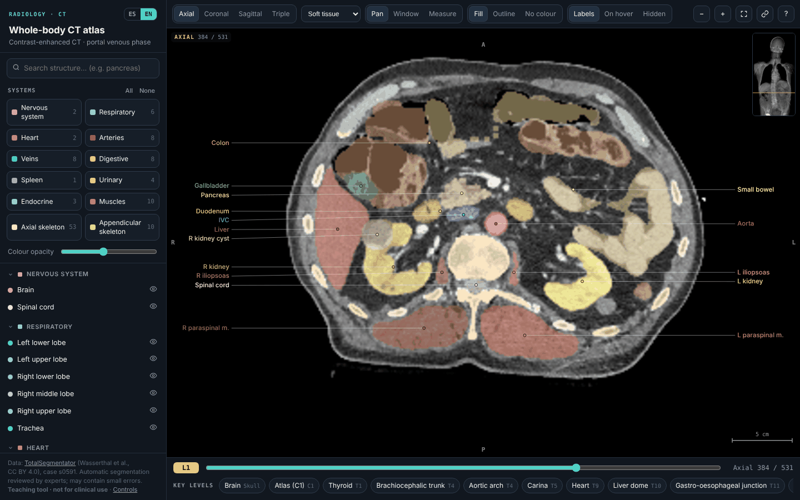

# Whole-body CT atlas · Atlas TC de cuerpo entero

**Live demo:** https://ferasmed-dev.github.io/whole-body-ct-atlas/ · English: https://ferasmed-dev.github.io/whole-body-ct-atlas/?lang=en

An interactive, browser-only atlas of a real contrast-enhanced CT from the skull vertex to the femoral heads. Scroll through axial, coronal and sagittal slices, or all three linked; switch 115 segmented structures on and off by system; hover any pixel for its name, system, vertebral level and Hounsfield value; and jump straight to the classic landmark levels (carina, aortic arch, gastro-oesophageal junction, renal hila, aortic bifurcation…). Spanish by default, with an English switch.



## What it shows

- **Real anatomy, not drawings.** One portal-venous-phase CT (1.5 mm isotropic voxels, 531 × 224 × 275) with expert-reviewed segmentations of 115 structures in 12 systems: nervous (2), respiratory (6 — the five lobes + trachea), heart (2), arteries (8), veins (8), digestive (8), spleen (1), urinary (4), endocrine (3), muscles (10), axial skeleton (53 — every vertebra C1–S1, all 24 ribs, sternum, sacrum, skull, costal cartilages) and appendicular skeleton (10).
- **Three planes, or all three linked.** In the triple view a click in any plane moves the crosshair and the other two follow. A coronal scout shows where the axial slice sits.
- **Labels with leader lines**, placed in two columns that never overlap. Organs and vessels get priority over bones; vertebrae are labelled automatically in the sagittal plane, where they line up; ribs are labelled on hover or selection.
- **Hover to identify** (name in both languages, system, vertebral level, HU). Click to select. **Isolate** shows one structure alone.
- **Windowing** with the standard presets (soft tissue 40/400, mediastinum 50/350, lung −600/1500, bone 400/1800, brain 40/80, liver 70/170, vascular 150/600) and free window/level by dragging.
- **Vertebral level of every axial slice**, computed from the vertebra masks (disc spaces show as "T12–L1").
- **Key levels**: 17 one-click landmarks, each with its vertebral level in this patient.
- **Measure** distances in mm. **Fill / outline / no-colour** overlays with adjustable opacity.
- **Phone-friendly**: swipe to scroll slices, pinch to zoom, two fingers to pan; the structure list becomes a drawer.

## Curriculum fit

For students and teachers at any Spanish medical faculty. Cross-sectional anatomy belongs to **Module I** (*Morfología, estructura y función del cuerpo humano*) and imaging to **Module IV** (*Procedimientos diagnósticos y terapéuticos*) of Orden ECI/332/2008. It supports *Anatomía Humana* (all faculties), and *Radiología General* / *Radiología y Medicina Física* / *Diagnóstico por la Imagen*, whatever each faculty calls them. Recognising structures and vertebral levels on CT is routinely examined in the MIR image questions.

## For teachers

Every view can be shared as a link, so you can project or send an exact slice. The **link** button in the toolbar copies the current state. You can also write the parameters by hand:

| Parameter | Values | Example |
|---|---|---|
| `view` | `axial` (default), `coronal`, `sagittal`, `triple` | `?view=triple` |
| `level` | key-level id (table below) | `?level=carina` |
| `s` | structure key (TotalSegmentator name) — selects and centres it | `?s=pancreas` |
| `iso` | `1` — show only the selected structure | `?s=aorta&iso=1` |
| `w` | `soft`, `mediastinum`, `lung`, `bone`, `brain`, `liver`, `vascular` | `?w=lung` |
| `z` | axial slice number (1–531, head → feet) | `?z=246` |
| `labels` | `all` (default), `hover`, `none` — `hover`/`none` turn it into a self-test | `?labels=none` |
| `lang` | `es` (default), `en` | `?lang=en` |

Ready-made links:

- Carina in the lung window: [`?level=carina&w=lung`](https://ferasmed-dev.github.io/whole-body-ct-atlas/?level=carina&w=lung)
- Pancreas, coronal, alone: [`?view=coronal&s=pancreas&iso=1`](https://ferasmed-dev.github.io/whole-body-ct-atlas/?view=coronal&s=pancreas&iso=1)
- Aorta in the triple view: [`?view=triple&s=aorta`](https://ferasmed-dev.github.io/whole-body-ct-atlas/?view=triple&s=aorta)
- Renal hila without labels (quiz): [`?level=renal-hila&labels=hover`](https://ferasmed-dev.github.io/whole-body-ct-atlas/?level=renal-hila&labels=hover)
- Spine in the bone window: [`?view=sagittal&w=bone`](https://ferasmed-dev.github.io/whole-body-ct-atlas/?view=sagittal&w=bone)

## Key levels

Computed from the masks by `tools/build.py`. The vertebral level is where it falls in this patient; textbook levels are the usual reference values (individual variation of one level is normal).

| id | Landmark | How it is found | This patient | Textbook |
|---|---|---|---|---|
| `brain` | Brain | median slice of the brain mask | — | — |
| `atlas` | Atlas (C1) | middle of C1 | C1 | C1 |
| `thyroid` | Thyroid | median slice of the thyroid | T1 | C5–T1 |
| `brachiocephalic-trunk` | Brachiocephalic trunk | lowest slice of the trunk (origin) | T4 | T3–T4 |
| `aortic-arch` | Aortic arch | top of the aorta + 6 mm | T4 | T4 |
| `carina` | Carina | first slice where the trachea splits in two | T5 | T4–T5 |
| `heart` | Heart | median slice of the heart (≈ four-chamber) | T9 | T8–T9 |
| `liver-dome` | Liver dome | top of the liver + 4.5 mm | T10 | T8–T9 |
| `gej` | Gastro-oesophageal junction | lowest slice of the oesophagus | T11 | T11 (hiatus T10) |
| `portal-vein` | Portal vein | median slice of the portal/splenic vein | T12 | L1–L2 |
| `pancreas` | Pancreas | median slice of the pancreas | T12 | L1–L2 |
| `renal-hila` | Renal hila | mean of the two kidney median slices | L1 | L1–L2 |
| `aortic-bifurcation` | Aortic bifurcation | lowest slice of the aorta | L4 | L4 |
| `ivc-confluence` | Iliac confluence (IVC) | lowest slice of the IVC | L4 | L5 |
| `sacral-promontory` | Sacral promontory | top of the sacrum + 3 mm | L5 (lower end) | S1 |
| `bladder` | Bladder | median slice of the bladder | sacrum | — |
| `femoral-heads` | Femoral heads | top of the femurs + 9 mm | sacrum | — |

Mean attenuation in this study (portal venous phase), useful for teaching HU: lung (right upper lobe) −686 HU, liver 101, spleen 129, kidney 164, aorta 235, portal/splenic vein 159, urine 15, gallbladder 8, femur 353.

## Data and processing

- **Source:** case **s0591** of the [TotalSegmentator dataset v2.0.1](https://zenodo.org/records/10047263) (University Hospital Basel, CC BY 4.0). It was chosen from the 102-case subset as the scan with contrast, low noise, complete brain and arms down that also covers the femoral heads.
- **`tools/build.py`** (Python 3, numpy, scipy; no other dependencies — `tools/nii.py` reads NIfTI directly):
  1. reorients to the display convention (radiological: patient right on the screen's left; anterior up; head first);
  2. crops to the body and sets everything outside it (table, clothing) to air (−1000 HU);
  3. cleans each mask (solid organs and bones keep their largest connected piece; others drop pieces < 5 % of the largest) — this removed, for example, a stray "L4" fragment inside the skull;
  4. merges the masks into one label map (smaller structures painted last so they stay visible on overlaps);
  5. computes the per-slice vertebral level and the key levels;
  6. writes `data/ct.bin` (int16 HU, byte-shuffled, gzip — 16 MB), `data/labels.bin` (uint8, gzip — 0.6 MB) and `data/atlas.json` (names ES/EN, systems, colours, bounding boxes, levels).
- **`tools/catalog.py`** holds the Spanish (Terminologia Anatomica as used in Spanish faculties) and English names, the systems and the colours.
- **`tools/b64split.py`** writes base64 text copies of the binaries, for hosts that refuse `.bin` files; the viewer falls back to them automatically.

To rebuild from the dataset:

```bash
python3 tools/build.py /path/to/Totalsegmentator_dataset_small_v201/s0591 data
```

## Known limitations

- **Coverage** ends at the femoral heads (skull to hips). Lower limbs are not included.
- **One patient.** Normal variation (one vertebral level either way) is expected. The scan comes from a trauma CT (dataset metadata: trauma, thorax), so the thorax may show non-anatomical findings.
- **Automatic segmentation.** The dataset's masks were reviewed by experts but edges can be off by a voxel or two, especially small vessels and bowel. The prostate mask is empty in this case and is not listed.
- **What is not segmented** by the source dataset: coeliac trunk, superior mesenteric artery and vein, renal vessels, lymph nodes, abdominal-wall muscles, intracranial anatomy beyond "brain". Key levels such as the coeliac trunk therefore cannot be computed.
- Key levels are computed rules (see the table), not hand-picked slices.

## Layout

```
index.html            page shell (Spanish by default)
src/core.js           pure functions: decoding, windowing LUT, plane geometry, slice extraction, label layout, search, deep links
src/i18n.js           all interface strings, ES + EN
src/ui.js             loading, canvas rendering, interaction, sidebar, language switch; exposes window.__atlas for checks
src/styles.css        dark workstation look; panels follow the OS light/dark setting
data/                 ct.bin, labels.bin, atlas.json (generated)
tools/                Python data pipeline
tests/                node:test — core functions + data integrity and anatomical sanity checks
docs/screenshot.png
```

## Run locally

ES modules and `fetch` need a web server (opening the file directly will not work):

```bash
python3 -m http.server 8000
# open http://localhost:8000
```

## Tests

```bash
npm test     # node --test, Node 20+
```

19 tests: byte decoding, windowing, plane geometry round-trips, slice extraction in every plane, label anchoring and layout, search, deep-link validation, and checks on the shipped data — sizes and voxel counts, bilingual names, physiological HU (lung < −600, enhanced aorta > 120, liver 60–160, urine −10 to 40, bone > 250), radiological orientation (liver left of spleen on screen, sternum anterior to the cord, head before pelvis), vertebrae in order C1 → S1, and key levels within one level of the textbook value. They run on every push (`.github/workflows/test.yml`).

## Deploy

GitHub → Settings → Pages → Deploy from a branch → `main` / `(root)`. The site appears at `https://ferasmed-dev.github.io/whole-body-ct-atlas/` after a minute or two.

## References

- Wasserthal J, Breit HC, Meyer MT, et al. TotalSegmentator: robust segmentation of 104 anatomic structures in CT images. *Radiol Artif Intell.* 2023;5(5):e230024. Dataset v2.0.1: https://zenodo.org/records/10047263 (CC BY 4.0).
- Federative International Programme for Anatomical Terminology. *Terminologia Anatomica*, 2nd ed. 2019.
- Standard window settings and vertebral landmark levels as in Moore KL, Dalley AF, Agur AMR. *Clinically Oriented Anatomy* and Weir J, Abrahams PH. *Imaging Atlas of Human Anatomy*.

## Licence

Code: MIT © 2026 Feras Elhissi. Data in `data/`: derived from TotalSegmentator, CC BY 4.0 — see [LICENSE](LICENSE).

*Teaching tool · not for clinical use.*
